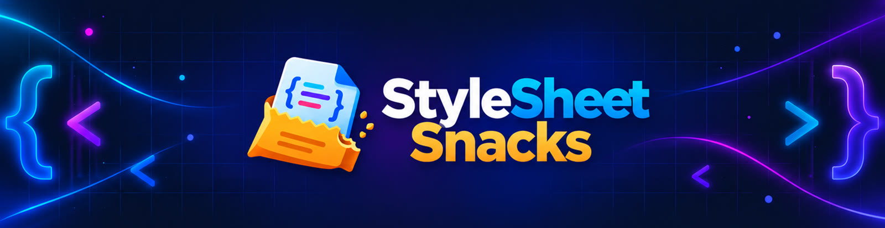

<b>Bite-sized CSS animations. Zero JavaScript. 🍬</b>

  <a href="https://www.youtube.com/@StyleSheetSnacks">▶️ YouTube channel</a> ·
  <a href="https://benshabbat.github.io/stylesheet-snacks/">✨ Live gallery</a>

Every effect here is a YouTube Short where the code is typed live and the result runs next to it.
Each folder has a tiny `index.html` and the full `style.css`. Open it, copy it, use it.

## Effects (14 out, 78 coming soon 🔜)

| # | Effect | Code | Live |
|---|--------|------|------|
| 01 | Animated Neon Button | [code](effects/01-animated-neon-button/style.css) | [demo](https://benshabbat.github.io/stylesheet-snacks/effects/01-animated-neon-button/) |
| 02 | Spinning Gradient Border | [code](effects/02-spinning-gradient-border/style.css) | [demo](https://benshabbat.github.io/stylesheet-snacks/effects/02-spinning-gradient-border/) |
| 03 | Bouncing Dots Loader | [code](effects/03-bouncing-dots-loader/style.css) | [demo](https://benshabbat.github.io/stylesheet-snacks/effects/03-bouncing-dots-loader/) |
| 04 | Flickering Neon Text | [code](effects/04-neon-text-flicker/style.css) | [demo](https://benshabbat.github.io/stylesheet-snacks/effects/04-neon-text-flicker/) |
| 05 | Shimmering Gradient Text | [code](effects/05-shimmer-gradient-text/style.css) | [demo](https://benshabbat.github.io/stylesheet-snacks/effects/05-shimmer-gradient-text/) |
| 06 | Smooth Ring Spinner | [code](effects/06-ring-spinner/style.css) | [demo](https://benshabbat.github.io/stylesheet-snacks/effects/06-ring-spinner/) |
| 07 | Pulsing Ring Effect | [code](effects/07-pulse-ring-button/style.css) | [demo](https://benshabbat.github.io/stylesheet-snacks/effects/07-pulse-ring-button/) |
| 08 | Morphing Gradient Blob | [code](effects/08-morphing-blob/style.css) | [demo](https://benshabbat.github.io/stylesheet-snacks/effects/08-morphing-blob/) |
| 09 | Wavy Bouncing Letters | [code](effects/09-wave-text/style.css) | [demo](https://benshabbat.github.io/stylesheet-snacks/effects/09-wave-text/) |
| 10 | Skeleton Loading Shimmer | [code](effects/10-skeleton-loader/style.css) | [demo](https://benshabbat.github.io/stylesheet-snacks/effects/10-skeleton-loader/) |
| 11 | Animated Aurora Background | [code](effects/11-aurora-background/style.css) | [demo](https://benshabbat.github.io/stylesheet-snacks/effects/11-aurora-background/) |
| 12 | Gradient Progress Bar | [code](effects/12-progress-bar-fill/style.css) | [demo](https://benshabbat.github.io/stylesheet-snacks/effects/12-progress-bar-fill/) |
| 13 | Floating Glass Card | [code](effects/13-glassmorphism-card/style.css) | [demo](https://benshabbat.github.io/stylesheet-snacks/effects/13-glassmorphism-card/) |
| 15 | 3D Flip Card | [code](effects/15-3d-flip-card/style.css) | [demo](https://benshabbat.github.io/stylesheet-snacks/effects/15-3d-flip-card/) |

### 🔜 Coming soon

78 more snacks are on the way. A new one lands here the day its Short goes live.
[Subscribe on YouTube](https://www.youtube.com/@StyleSheetSnacks) so you don't miss them.

## Run locally

No build step. Open any `effects/<name>/index.html` in your browser, or open `index.html` for the full gallery.

## License

[MIT](LICENSE). Use the snippets in any project, personal or commercial.

🔔 New snacks every day on [YouTube](https://www.youtube.com/@StyleSheetSnacks).
